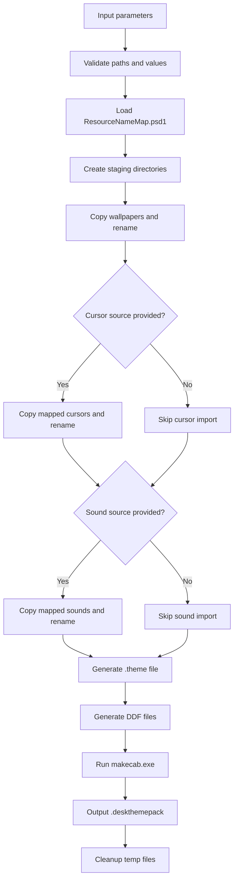

# Themify Module RedMe

## Process flow

1. Validate parameters and source paths.
2. Load resource mapping from [ResourceNameMap.psd1](./ResourceNameMap.psd1).
3. Build a temporary staging folder with:
   - `DesktopBackground`
   - `Cursors`
   - `Sounds`
4. Copy and rename wallpapers to:
   - `<ThemeName>.Wallpaper<Index>.<ext>`
5. Optionally copy and rename mapped cursor files to:
   - `<ThemeName>.Cursor.<LogicalName>.<ext>`
6. Optionally copy and rename mapped sound files to:
   - `<ThemeName>.Sounds.<LogicalName>.<ext>`
7. Generate `<ThemeName>.theme` metadata file.
8. Generate one or more DDF files for `makecab.exe`.
9. Build `.deskthemepack` package with `makecab.exe`.
10. Clean temporary artifacts.

## Mermaid diagram



## Validated command examples

The following commands are aligned with and validated by [tests/Themify.Tests.ps1](./tests/Themify.Tests.ps1):

```powershell
Import-Module .\Themify.psd1 -Force

$params = @{
    SourcePath  = 'C:\Temp\Wallpapers'
    ThemeName   = 'Theme01'
    OutputPath  = 'C:\Temp\Theme01'
    SlideshowInterval = 600000
    PassThru    = $true
}

New-ThemifyDesktopThemePack @params
```

```powershell
Import-Module .\Themify.psd1 -Force

$params = @{
    SourcePath       = 'C:\Temp\Wallpapers'
    ThemeName        = 'Theme01'
    OutputPath       = 'C:\Temp\Theme01.deskthemepack'
    CursorSourcePath = 'C:\Temp\CursorAssets'
    SoundSourcePath  = 'C:\Temp\SoundAssets'
    ResourceMapPath  = '.\ResourceNameMap.psd1'
    PassThru         = $true
}

New-ThemifyDesktopThemePack @params
```

## Update notes

- GUI flow was intentionally not implemented.
- Parameters are now the primary UX for automation and scripting.
- Resource naming is standardized and theme-prefixed for wallpapers, cursors, and sounds.
- Mapping for cursors and sounds is externalized in a PSD1 file for customization.
